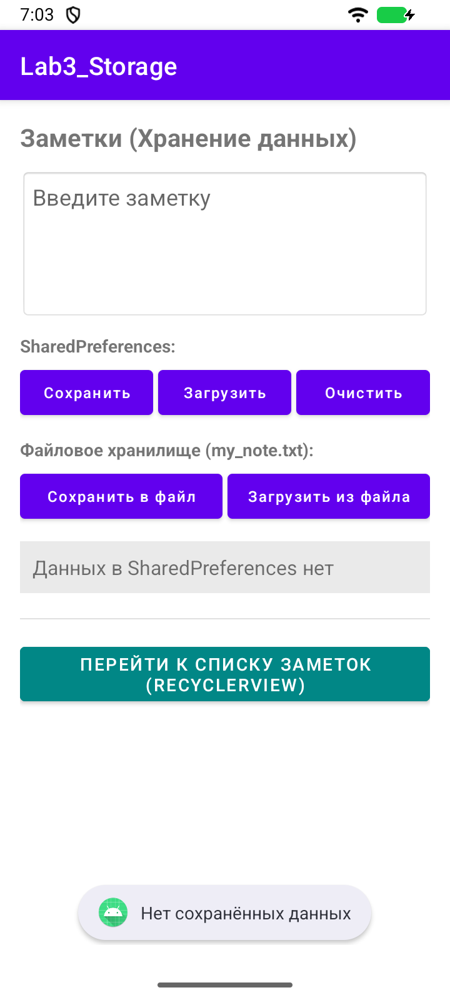
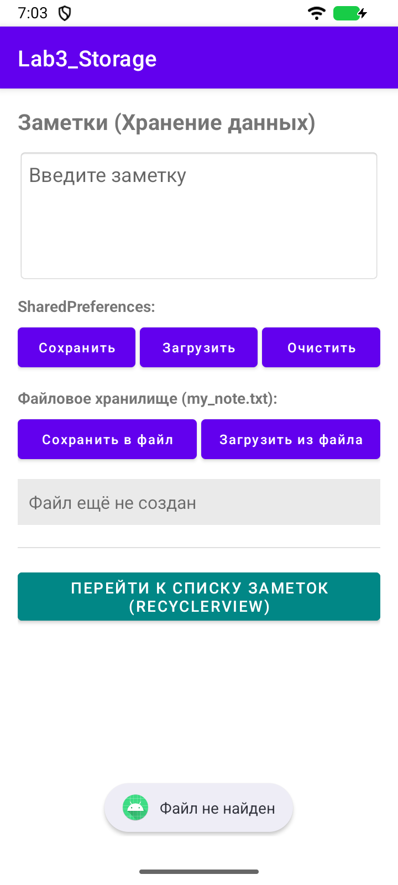
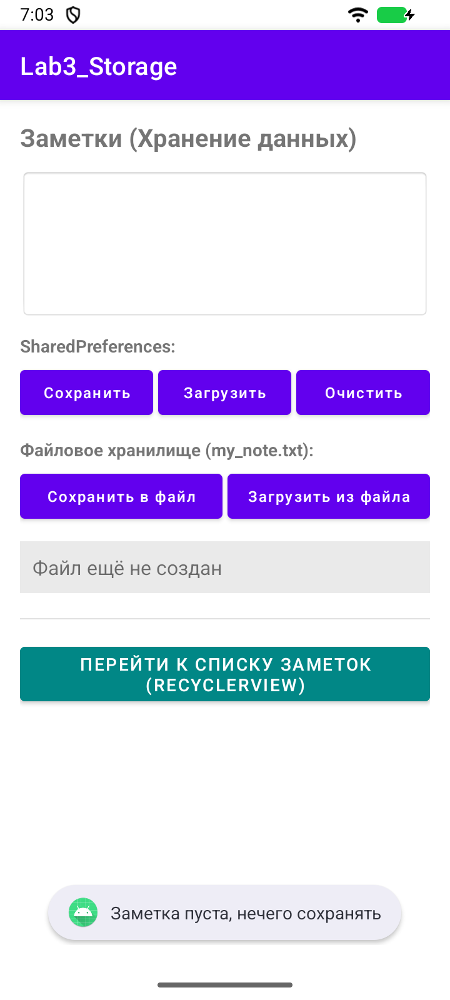
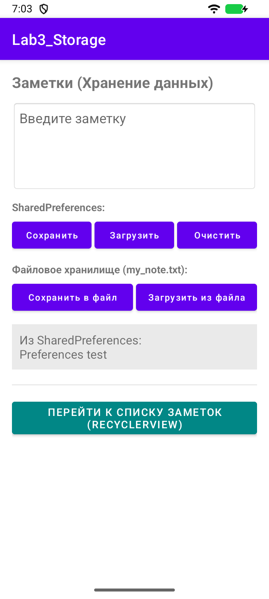
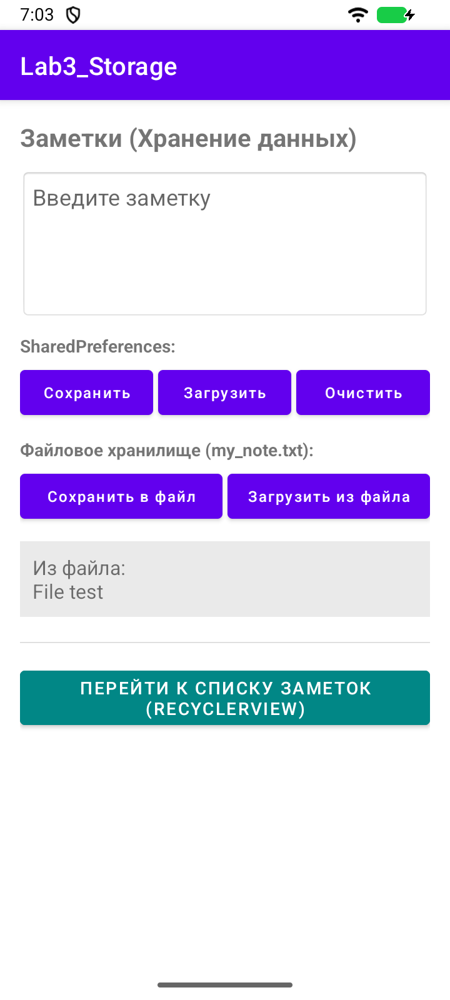
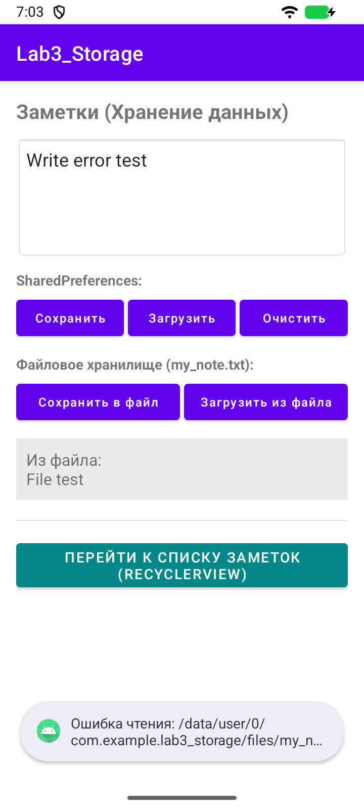
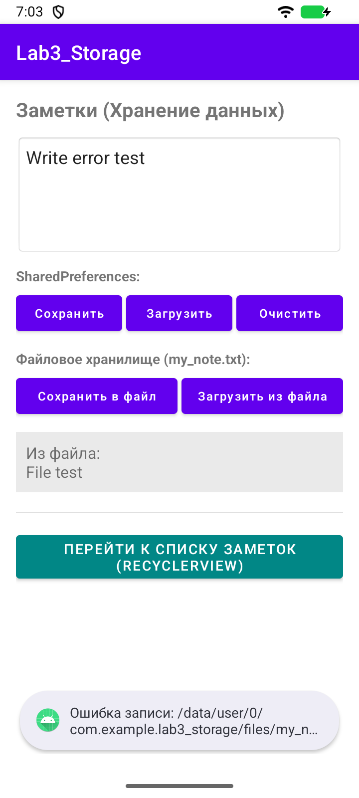
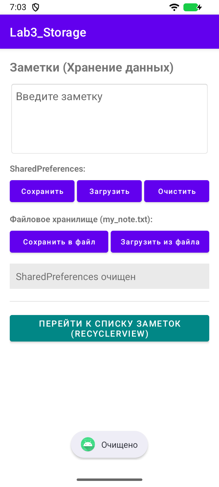
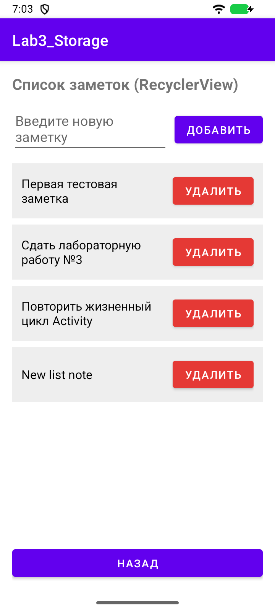
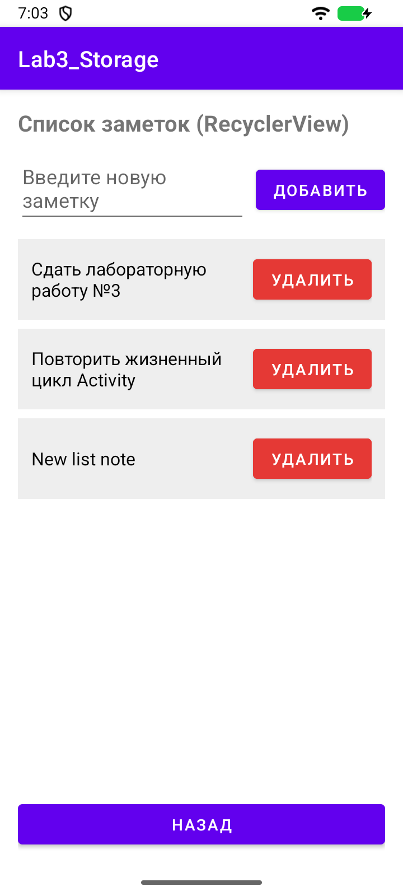

# Лабораторная работа 3

## Хранение заметок и RecyclerView

Студент: Ретунский Савелий. Проверка: 10 ноября 2026 года.

## Цель

Освоить SharedPreferences, приватные файлы и динамический список заметок.

## Структура

MainActivity → SharedPreferences / filesDir. MainActivity → RecyclerActivity → RecyclerView → NotesAdapter → NoteViewHolder. RecyclerView размещает карточки, Adapter связывает список с карточками, ViewHolder хранит ссылки на View.

## Реализация и исправления

1. SharedPreferences хранит строку под ключом saved_note. Сохранение: putString + apply; загрузка обрабатывает null/пустое значение; очистка удаляет ключ и очищает интерфейс.

2. File(filesDir, "my_note.txt") используется с writeText/readText и exists(). Пустой и пробельный ввод не сохраняется, ошибки чтения/записи перехватываются и показываются Toast.

3. Зависимость RecyclerView подключена. Список MutableList передаётся в адаптер; добавление вызывает notifyItemInserted, удаление — removeAt и notifyItemRemoved. Позиция берётся через bindingAdapterPosition с проверкой NO_POSITION.

4. Добавлено сохранение списка в Bundle при пересоздании Activity.

## Проверка

Сборка `assembleDebug assembleDebugAndroidTest lintDebug`: успешно. Android Lint: 0 ошибок, 54 предупреждений. Предупреждения включают строки в XML вместо ресурсов, локализацию и рекомендации по зависимостям; они не скрыты baseline-файлом.

Эмулятор: Medium Phone, Android 16 API 36.1, x86_64. Тест `LabRegressionTest`: пройден. Исходник теста: [LabRegressionTest.kt](../app/src/androidTest/java/com/example/lab3_storage/LabRegressionTest.kt).

`connectedDebugAndroidTest` в этой Windows-среде не запустил Gradle Worker (`GradleWorkerMain` не найден). Те же собранные тестовые APK запускались через `adb shell am instrument -w …/androidx.test.runner.AndroidJUnitRunner`. Для повторения: `./verify.ps1 -DeviceTests` на отдельном эмуляторе. Скрипт очищает учебные данные приложения на эмуляторе.

Лог запуска:

```text
com.example.lab3_storage.LabRegressionTest:.

Time: 55.008

OK (1 test)
```

## Скриншоты сценариев

### 01-no-preferences



### 02-no-file



### 03-empty-input



### 04-preferences-loaded



### 05-file-loaded



### 05-file-read-error



### 05-file-write-error



### 06-cleared



### 07-list-added



### 08-list-deleted



## Фрагменты кода

### MainActivity.kt

[Полный исходник](../app/src/main/java/com/example/lab3_storage/MainActivity.kt)

```kotlin
findViewById<Button>(R.id.btnSaveSP).setOnClickListener {
            val text = etNote.text.toString().trim()
            if (text.isEmpty()) {
                Toast.makeText(this, "Заметка пуста, нечего сохранять", Toast.LENGTH_SHORT).show()
                return@setOnClickListener
            }
            sp.edit().putString(PREF_KEY, text).apply()
            Toast.makeText(this, "Сохранено в SharedPreferences", Toast.LENGTH_SHORT).show()
            etNote.text.clear()
        }
```

### MainActivity.kt

[Полный исходник](../app/src/main/java/com/example/lab3_storage/MainActivity.kt)

```kotlin
findViewById<Button>(R.id.btnLoadSP).setOnClickListener {
            val savedText = sp.getString(PREF_KEY, null)
            if (savedText.isNullOrEmpty()) {
                tvResult.text = "Данных в SharedPreferences нет"
                Toast.makeText(this, "Нет сохранённых данных", Toast.LENGTH_SHORT).show()
            } else {
                tvResult.text = "Из SharedPreferences:\n$savedText"
            }
        }
```

### MainActivity.kt

[Полный исходник](../app/src/main/java/com/example/lab3_storage/MainActivity.kt)

```kotlin
findViewById<Button>(R.id.btnClearSP).setOnClickListener {
            sp.edit().remove(PREF_KEY).apply()
            etNote.text.clear()
            tvResult.text = "SharedPreferences очищен"
            Toast.makeText(this, "Очищено", Toast.LENGTH_SHORT).show()
        }
```

### MainActivity.kt

[Полный исходник](../app/src/main/java/com/example/lab3_storage/MainActivity.kt)

```kotlin
findViewById<Button>(R.id.btnSaveFile).setOnClickListener {
            val text = etNote.text.toString().trim()
            if (text.isEmpty()) {
                Toast.makeText(this, "Заметка пуста, нечего сохранять", Toast.LENGTH_SHORT).show()
                return@setOnClickListener
            }
            try {
                val file = File(filesDir, FILE_NAME)
                file.writeText(text)
                Toast.makeText(this, "Сохранено в файл", Toast.LENGTH_SHORT).show()
                etNote.text.clear()
            } catch (e: Exception) {
                Toast.makeText(this, "Ошибка записи: ${e.message}", Toast.LENGTH_SHORT).show()
            }
        }
```

### MainActivity.kt

[Полный исходник](../app/src/main/java/com/example/lab3_storage/MainActivity.kt)

```kotlin
findViewById<Button>(R.id.btnLoadFile).setOnClickListener {
            val file = File(filesDir, FILE_NAME)
            if (file.exists()) {
                try {
                    val content = file.readText()
                    tvResult.text = "Из файла:\n$content"
                } catch (e: Exception) {
                    Toast.makeText(this, "Ошибка чтения: ${e.message}", Toast.LENGTH_SHORT).show()
                }
            } else {
                tvResult.text = "Файл ещё не создан"
                Toast.makeText(this, "Файл не найден", Toast.LENGTH_SHORT).show()
            }
        }
```

### NotesAdapter.kt

[Полный исходник](../app/src/main/java/com/example/lab3_storage/NotesAdapter.kt)

```kotlin
class NotesAdapter(
    private var notes: MutableList<String>,
    private val onDelete: (Int) -> Unit
) : RecyclerView.Adapter<NotesAdapter.NoteViewHolder>() {

    inner class NoteViewHolder(itemView: View) : RecyclerView.ViewHolder(itemView) {
        val tvText: TextView = itemView.findViewById(R.id.tvNoteText)
        val btnDelete: Button = itemView.findViewById(R.id.btnDelete)
    }

    override fun onCreateViewHolder(parent: ViewGroup, viewType: Int): NoteViewHolder {
        val view = LayoutInflater.from(parent.context)
            .inflate(R.layout.item_note, parent, false)
        return NoteViewHolder(view)
    }

    override fun onBindViewHolder(holder: NoteViewHolder, position: Int) {
        holder.tvText.text = notes[position]
        holder.btnDelete.setOnClickListener {
            val currentPos = holder.bindingAdapterPosition
            if (currentPos != RecyclerView.NO_POSITION) {
                onDelete(currentPos)
            }
        }
    }

    override fun getItemCount(): Int = notes.size

    fun removeNote(position: Int) {
        if (position in 0 until notes.size) {
            notes.removeAt(position)
            notifyItemRemoved(position)
            notifyItemRangeChanged(position, notes.size - position)
        }
    }
}
```

### RecyclerActivity.kt

[Полный исходник](../app/src/main/java/com/example/lab3_storage/RecyclerActivity.kt)

```kotlin
override fun onCreate(savedInstanceState: Bundle?) {
        super.onCreate(savedInstanceState)
        setContentView(R.layout.activity_recycler)

        etNewNote = findViewById(R.id.etNewNote)
        btnAdd = findViewById(R.id.btnAdd)
        btnBack = findViewById(R.id.btnBack)
        rvNotes = findViewById(R.id.rvNotes)

        savedInstanceState?.getStringArrayList("notes")?.let {
            notesList.clear()
            notesList.addAll(it)
        }

        adapter = NotesAdapter(notesList) { position ->
            adapter.removeNote(position)
        }

        rvNotes.layoutManager = LinearLayoutManager(this)
        rvNotes.adapter = adapter

        // Добавление новой заметки в список
        btnAdd.setOnClickListener {
            val text = etNewNote.text.toString().trim()
            if (text.isEmpty()) {
                Toast.makeText(this, "Введите текст заметки", Toast.LENGTH_SHORT).show()
                return@setOnClickListener
            }

            notesList.add(text)
            val lastPosition = notesList.size - 1
            adapter.notifyItemInserted(lastPosition)
            etNewNote.text.clear()
        }

        btnBack.setOnClickListener {
            finish()
        }
    }
```

## Вывод

SharedPreferences подходит для небольших настроек и пар ключ–значение. Файл подходит для произвольного текста или документа. RecyclerView отвечает за отображение списка и переиспользование карточек; список второго задания хранится в памяти, а не в базе данных.
